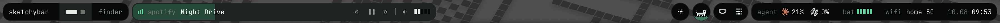
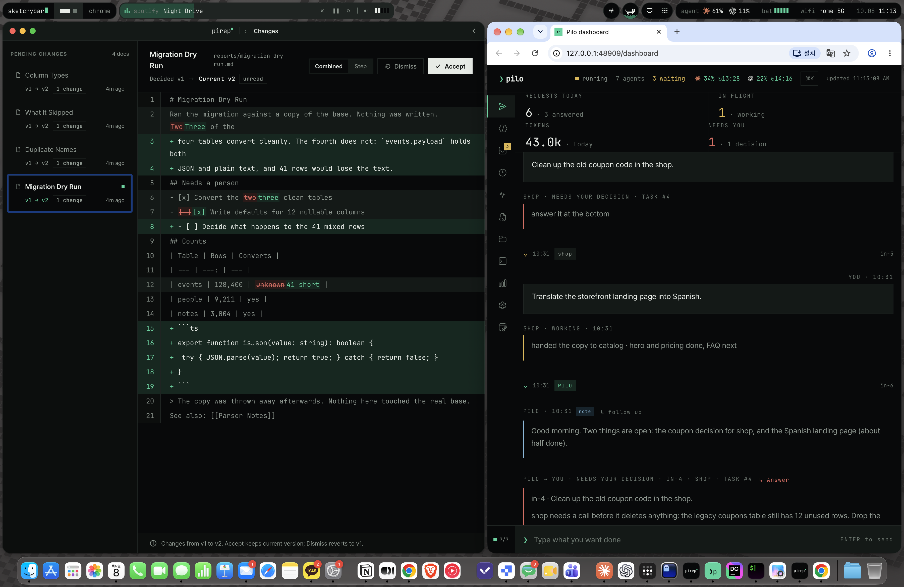
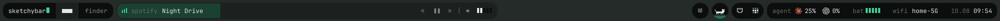
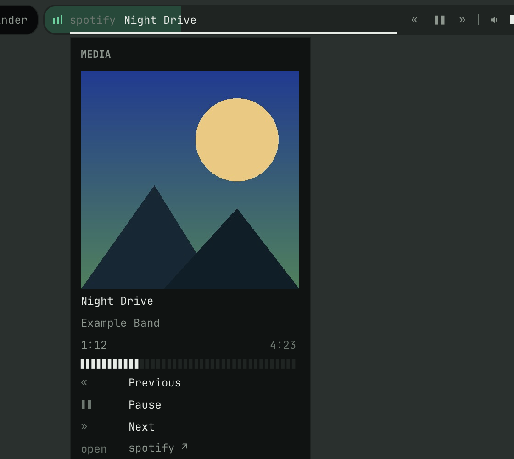
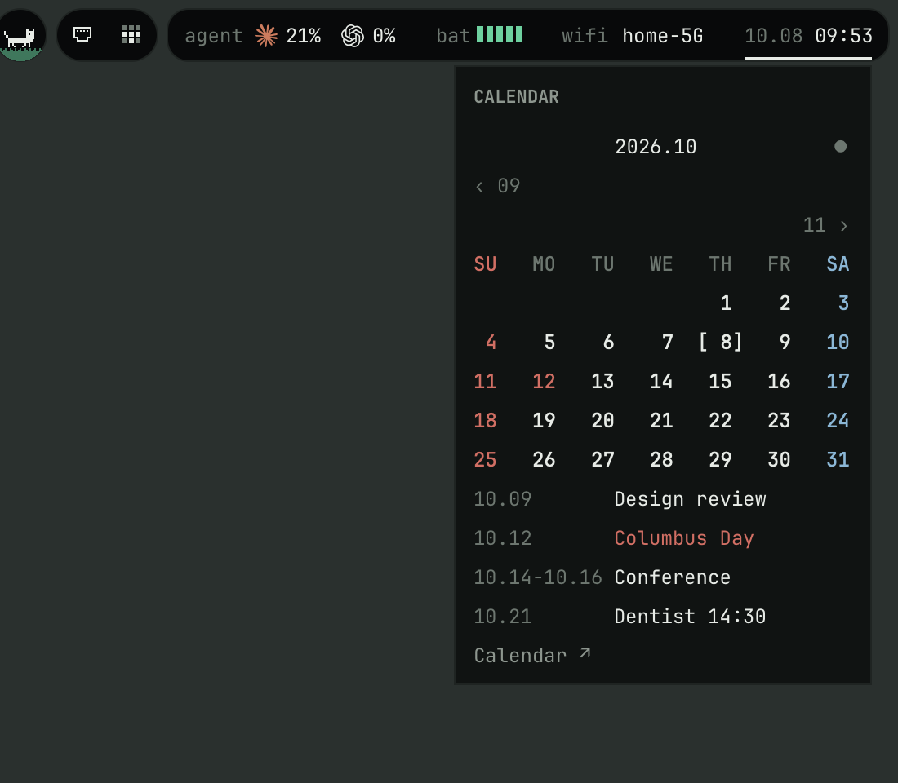
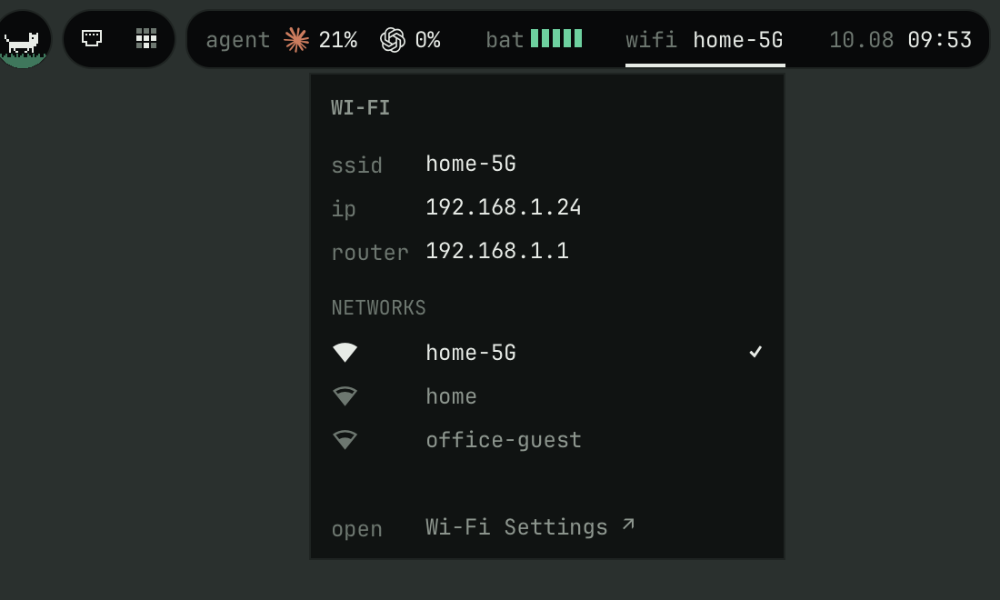
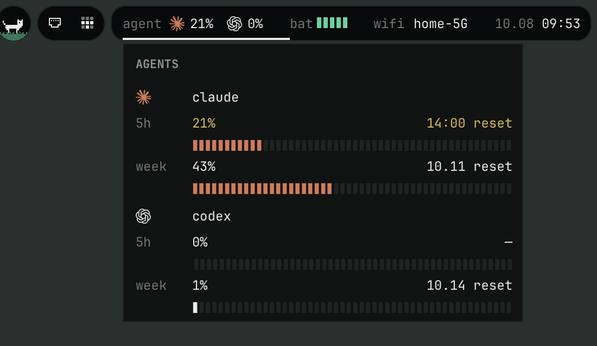
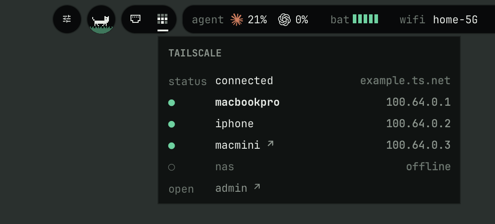
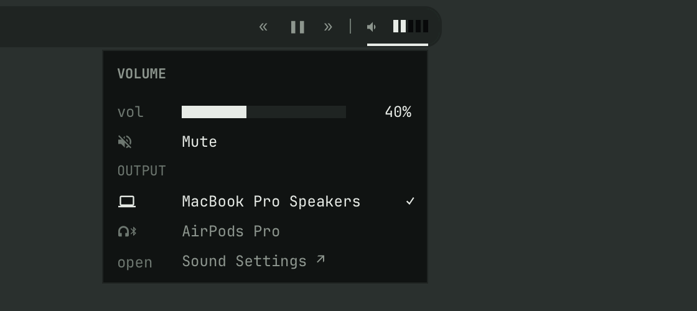

# sketchybar-island

A [SketchyBar](https://github.com/FelixKratz/SketchyBar) setup built around the MacBook notch: two "islands" left and right of the notch, a media island that fills the space up to it, and small popups for everything.



Full screen:



On a display without a notch the media island ends 5pt left of the screen centre:



| | |
|---|---|
|  |  |
|  |  |
|  |  |

## What's in it

- **Left island** — wordmark, spaces, front app (click: the app's menus in a popup)
- **Media island** — now playing with a progress fill, controls, volume + output device switcher
- **Circles** — settings, a pixel cat that runs faster with CPU load (click: CPU / memory), listening ports, Tailscale devices
- **Right island** — Claude Code / Codex usage, battery, Wi-Fi (saved networks in range), calendar with holidays
- Dark / light theme, works on displays with or without a notch (no notch: the media island ends 5pt left of the screen centre)

## Requirements

- macOS 14+ (developed on macOS 26/27, Apple silicon)
- [Homebrew](https://brew.sh) and Xcode Command Line Tools (`xcode-select --install`) — the helpers are small Swift files compiled on install
- Installed by `install.sh`: SketchyBar, JetBrains Mono, JetBrainsMono Nerd Font, [media-control](https://github.com/ungive/media-control)

Optional — each part hides or degrades without it:

| Tool | Used for |
|---|---|
| Claude Code / Codex | agent usage cell (hidden if neither is installed) |
| [Rectangle](https://github.com/rxhanson/Rectangle) | auto-maximise new windows (`AUTOMAX` in `config.sh`) |
| Ghostty | opening the config / long lists in a terminal (falls back to the default text editor) |
| Tailscale, Docker / OrbStack, ollama, `gh` | their cells and popups |

## Install

```sh
git clone https://github.com/garamnohhh/sketchybar-island.git && cd sketchybar-island
bash install.sh
```

An existing `~/.config/sketchybar` is moved to `~/.config/sketchybar.bak.<timestamp>`.

One-time setup:

1. System Settings → Menu Bar → *Automatically hide and show the menu bar*: **Always**
2. Privacy & Security → **Accessibility**: allow `sketchybar` (front-app menu popup)
3. First time you open the Wi-Fi popup: allow **Location** for "SketchyBar Wi-Fi Scan" (macOS only reveals nearby network names to apps with Location access; nothing is stored or sent)
4. First time you open the calendar popup: allow **Calendars**
5. Folder / git branch cell — add to `~/.zshrc`:

   ```zsh
   _sb_cwd() { sketchybar --trigger shell_cwd CWD="$PWD" &! }
   precmd_functions+=(_sb_cwd)
   ```

## Make it yours

Everything personal lives in **`config.sh`** — change these, then `sketchybar --reload`:

| Setting | Meaning |
|---|---|
| `WORDMARK` | the name at the left end |
| `THEME` | `dark` \| `light` \| `auto` |
| `BAR_DISPLAY` | `main`, or a display number from `sketchybar --query displays` |
| `WORK_DIR` | ports popup lists servers started under this folder |
| `HOLIDAY_CAL` | name of a subscribed holiday calendar in Calendar.app, e.g. `"US Holidays"` (empty = no holidays) |
| `AUTOMAX`, `AUTOMAX_INCLUDE`, `AUTOMAX_EXCLUDE` | auto-maximise new windows via Rectangle |
| `NOTIF_APPS`, `TERMINAL_APP` | Dock-badge apps, terminal used by popups |

Colours are tokens in `colors.sh`. Layout is `sketchybarrc`; each cell and popup is a script in `plugins/`; `helper/` holds the Swift sources (`helper/build.sh` rebuilds them).

## Notes

- **As-is.** This is a personal setup shared for reference. It is tuned for one machine (a 1800pt-wide notch display); expect to adjust things. No support promised.
- Nothing here talks to the network except what you click (opening URLs) — usage numbers, Wi-Fi, Tailscale and calendar data are read locally at runtime and are not part of this repository.

## Credits

- [SketchyBar](https://github.com/FelixKratz/SketchyBar) by Felix Kratz (GPL-3.0) — the bar itself; this repo is only configuration
- [JetBrains Mono](https://github.com/JetBrains/JetBrainsMono) (OFL-1.1) and [Nerd Fonts](https://github.com/ryanoasis/nerd-fonts) (MIT; bundled glyph sets under their own licences, incl. Material Design Icons — Apache-2.0 — and Codicons — CC-BY-4.0). Fonts are installed by Homebrew, not redistributed here
- [media-control](https://github.com/ungive/media-control) for now-playing data
- The Claude and OpenAI marks in the agent cell are Nerd Font glyphs; the names and logos belong to their owners
- Pixel icons (cat, port, Tailscale dots) were drawn for this setup

## License

[MIT](LICENSE)
